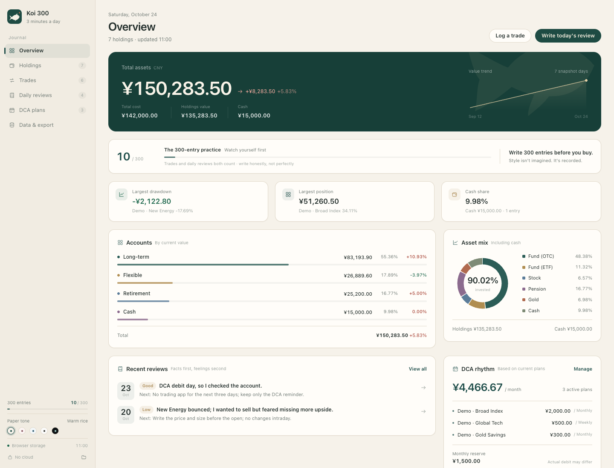
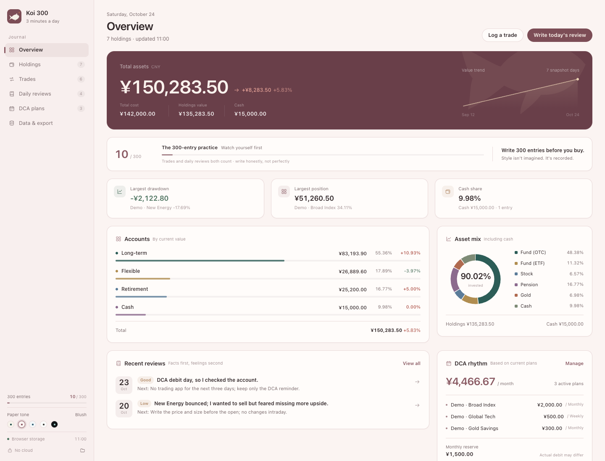
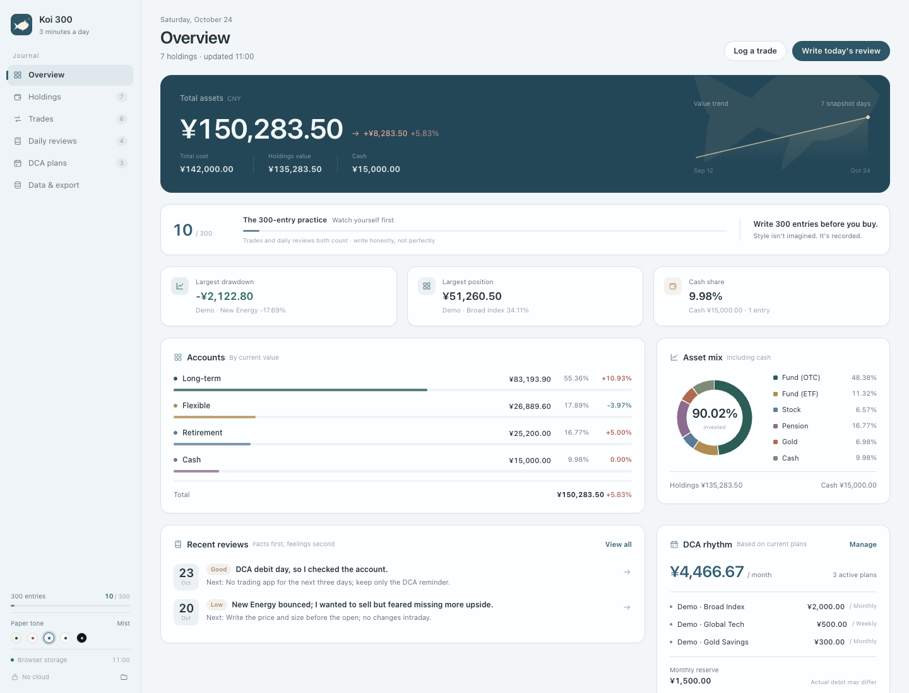
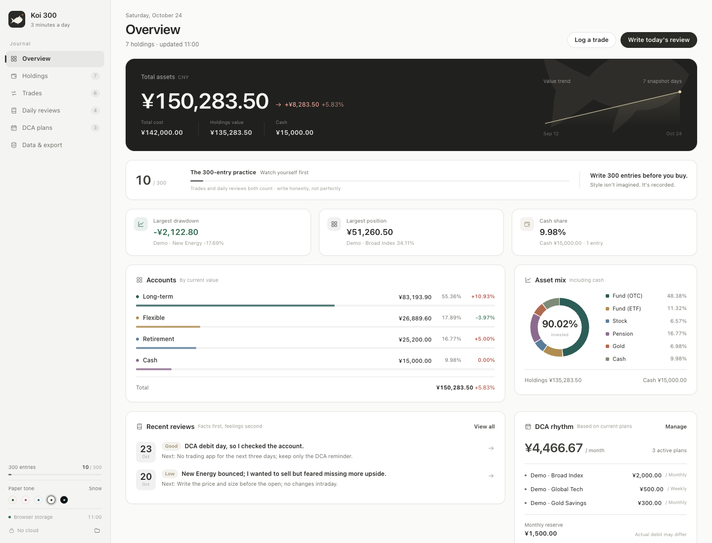
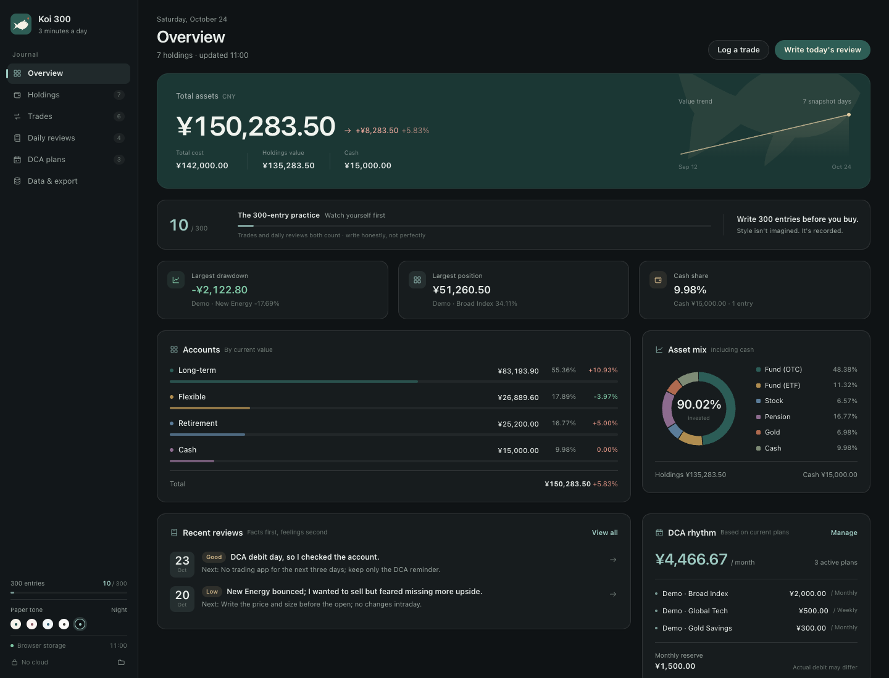
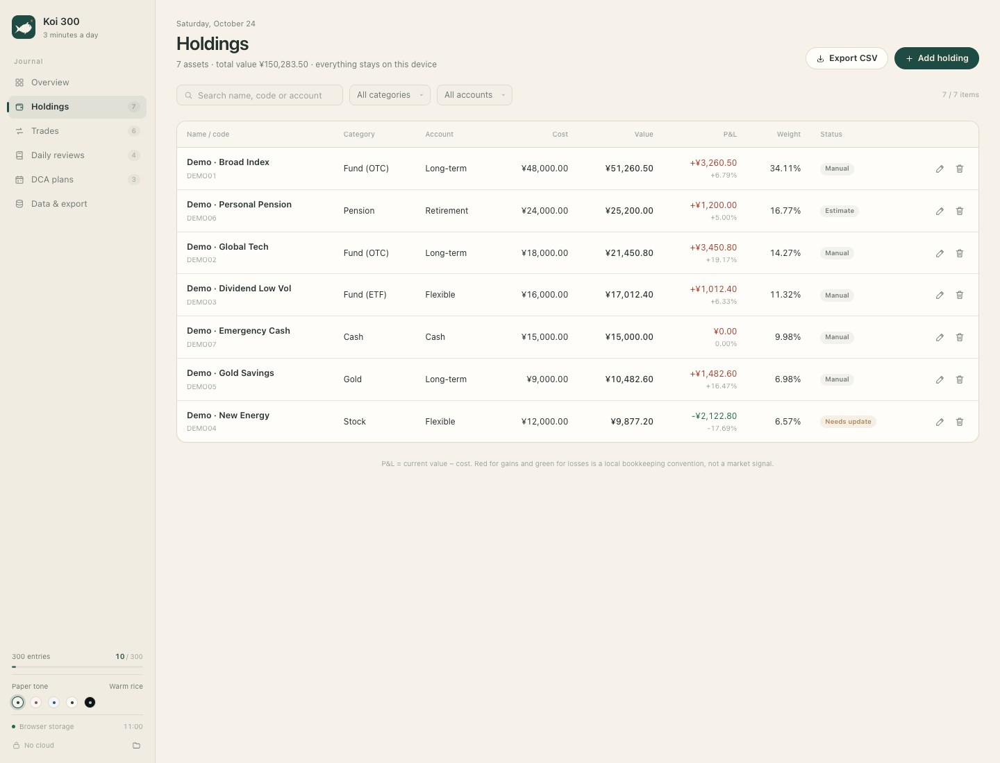
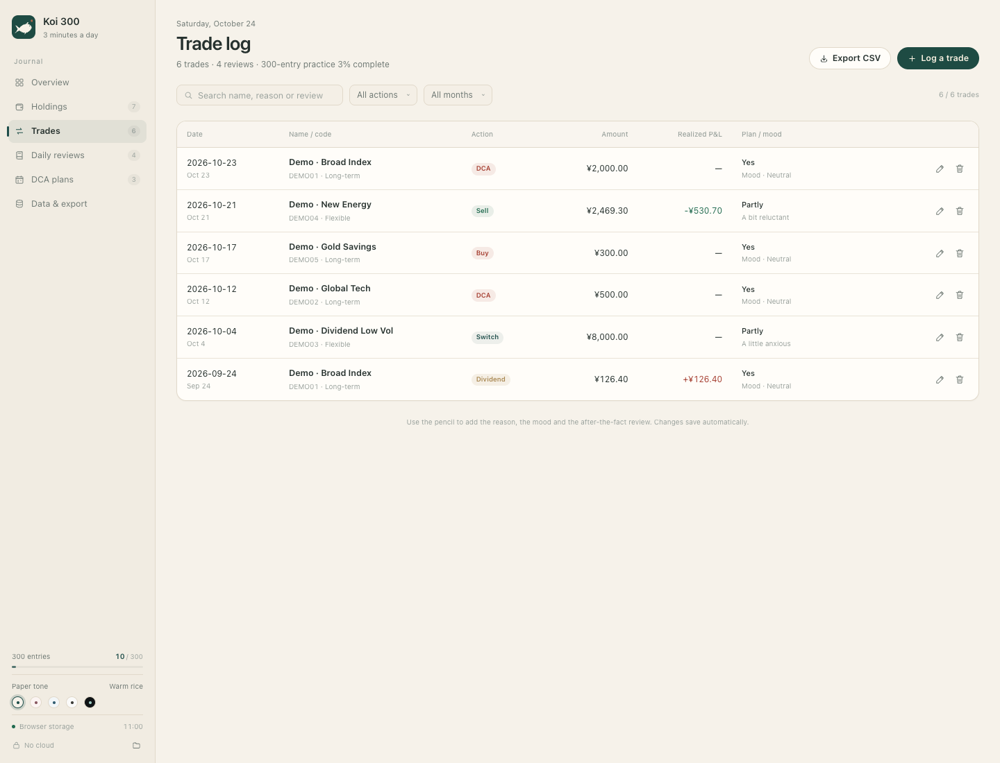
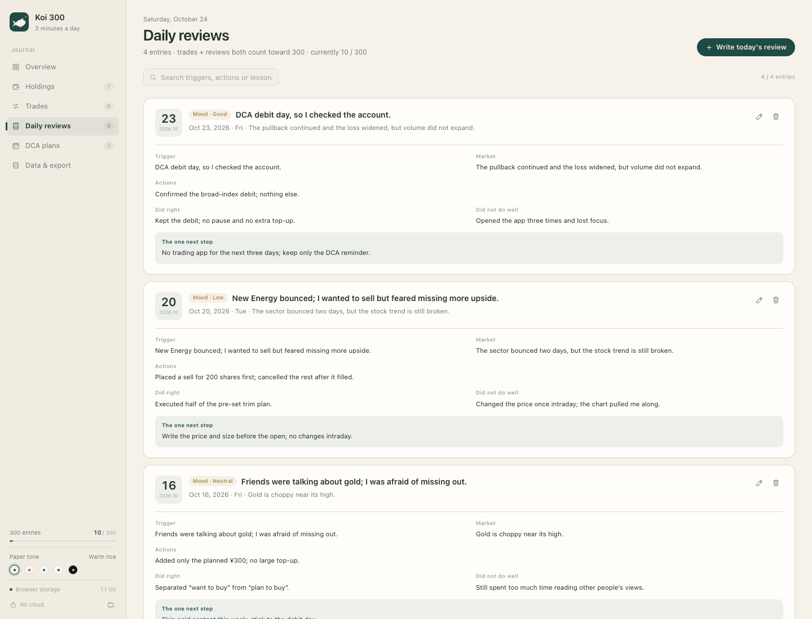
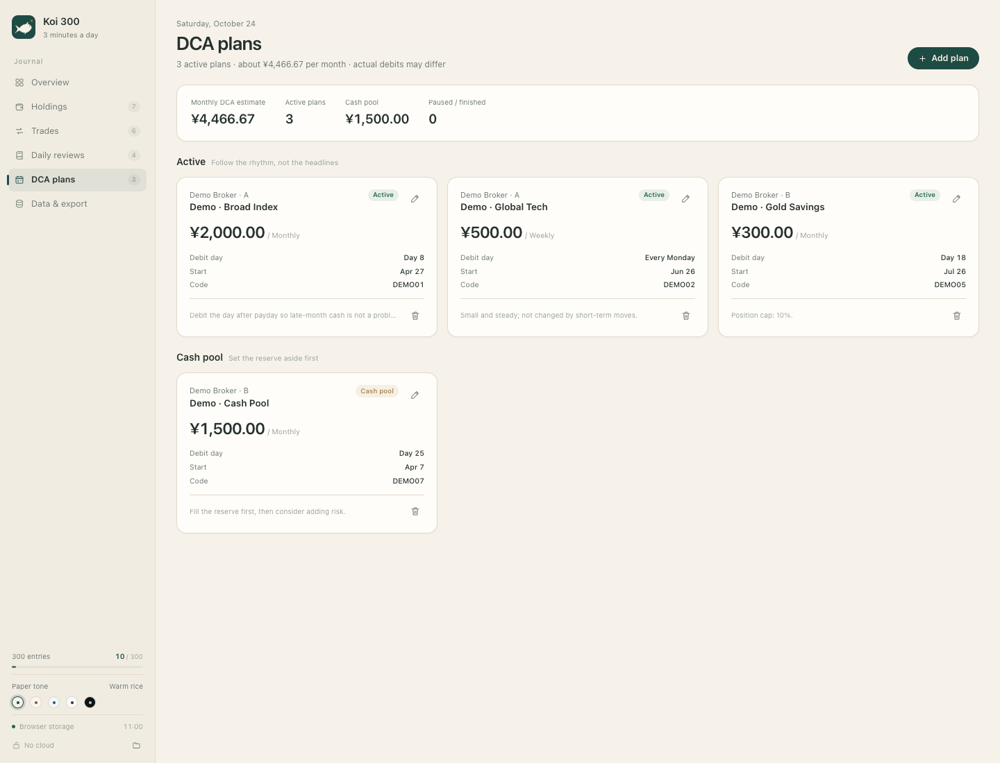
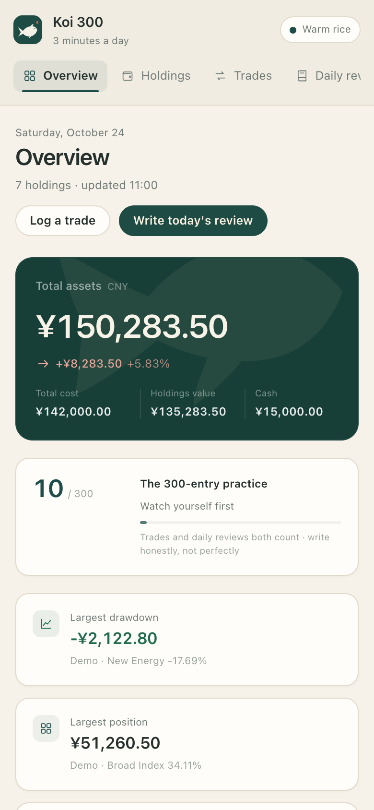

<p align="center">
  
</p>

# Koi 300

**Write 300 entries before you buy. Style isn't imagined. It's recorded.**

The mark is a koi: it doesn't chase the wave, it reads the current first.

A local-first investment review journal. Record holdings, trades and what you were thinking at the time; write a few lines of fact every day; let your own rhythm emerge. No account, no cloud, no price feed, and no predictions.

300 is a practice quota this project set for itself. It is not a quote from a famous investor, and not a promise of returns.

[Live demo](https://ohhhqz-star.github.io/koi-300/) · [Download](#download) · [Data format](docs/DATA.md) · [Privacy](PRIVACY.md) · [Notes for agents](AGENTS.md)



Five paper tones, switchable at any time:

<p>
  
  
  
  
</p>

<details>
<summary>More screens: holdings, trades, daily reviews, DCA plans</summary>






</details>

## What it is for

Most people don't lack more information. They lack a record they can look back on:

- Before buying, what did I actually see, fear and expect?
- Was this move part of a plan, or a sudden impulse?
- What did I do during the drawdown, and does it still hold up in hindsight?
- What position size, holding period and trade frequency actually fit my style?

Koi 300 keeps those answers on your machine. Trades and daily reviews both count toward the 300; the number isn't a KPI, it's a mirror.

## Features

- **Overview**: total assets, cost, cash, account split, asset classes, value trend, recent reviews, DCA rhythm.
- **Holdings**: account, category, cost, value, P&L, weight, note, next step.
- **Trades**: buy, sell, DCA, switch, dividend; each records the reason, mood, market and a later review.
- **Daily review**: mood, trigger, facts, what went right or wrong, and the one next step.
- **DCA plans**: platform, frequency, amount, debit day, status, cash pool.
- **300 entries**: trades plus reviews are counted automatically, across five stages from "watch yourself first" to "your style stands on its own".
- **Five paper tones**: warm rice, blush, mist, snow, night.
- **Take it anywhere**: full JSON backup; four CSVs (holdings, trades, reviews, plans) with a UTF-8 BOM so Excel and Numbers open them directly.
- **Local-file mode**: the data is plain JSON that an agent can read and write; the page notices external edits and refreshes.
- **Fully offline**: no CDN, analytics, font service or third-party request.

## Download

| Platform | File | Notes |
| --- | --- | --- |
| macOS 14+ | `Koi300-macOS-1.2.1-universal.zip` | Native SwiftUI app, universal for Apple Silicon and Intel |
| Windows 10/11 | `Koi300-Setup-1.2.1.exe` | NSIS installer, installs per-user, no admin rights needed |

Get them from [Releases](https://github.com/ohhhqz-star/koi-300/releases).

> The desktop app UI is currently in Chinese. The browser demo and all public documentation are in English. Both apps read and write the same JSON.

### First launch on macOS

The app has no Apple Developer certificate and is ad-hoc signed. On first launch:

1. Unzip and drag `Koi 300.app` into Applications.
2. Right-click the app → **Open** → **Open** again.
3. If macOS still blocks it, run:

```bash
xattr -dr com.apple.quarantine "/Applications/Koi 300.app"
```

Data lives at `~/Library/Application Support/Koi 300/data.json`.

### First launch on Windows

Double-click the installer and follow the wizard. It installs into your user folder, so no admin rights are needed; uninstalling does not delete your data.

Data lives at `%APPDATA%\Koi 300\data\portfolio.json`.

You can also open the folder from the app menu: File → Open data folder.

## Three ways to use it

### 1. Desktop app (recommended)

- macOS: native SwiftUI, data stored in Application Support.
- Windows: Electron shell plus a local Node server, running the same web UI in a window.
- Both import and export the same JSON.

### 2. Browser + local file (agent-friendly)

Requires Node.js 18+:

```bash
git clone https://github.com/ohhhqz-star/koi-300
cd koi-300
./start-mac.command        # macOS
# or double-click start-windows.bat on Windows
```

The browser opens `http://127.0.0.1:4877/`. Data is written to `data/portfolio.json` and backups to `data/backups/`. The server listens on the loopback interface only and stops when you close the terminal.

### 3. Browser only (GitHub Pages)

The [live demo](https://ohhhqz-star.github.io/koi-300/) uses browser `localStorage`; nothing to install. Data stays in this browser on this device, and switching browsers or clearing site data will lose it. Export JSON first if it matters.

<p>
  
</p>

## Hand it to an agent

In local-file mode the data is just a JSON file. You can ask an agent directly:

> Back up `data/portfolio.json` first, then read and edit my investment review data. Keep `schemaVersion=1`, the field names and all UUIDs unchanged; use `YYYY-MM-DD` dates. Write back to the same path; the app refreshes within a few seconds. Do not upload or commit anything to a public repository.

Or use the local API:

```bash
curl http://127.0.0.1:4877/api/status
curl http://127.0.0.1:4877/api/data
curl -X POST http://127.0.0.1:4877/api/backup
curl -X PUT -H 'Content-Type: application/json' \
  --data-binary @data/portfolio.json \
  http://127.0.0.1:4877/api/data
```

The API accepts same-origin requests from this machine only and rejects cross-site writes. **Do not forward port 4877 to the internet.**

Fields, enums and compatibility rules are in [docs/DATA.md](docs/DATA.md); project constraints for AI agents are in [AGENTS.md](AGENTS.md).

## Privacy

- No account, cloud sync, telemetry or ads.
- The app makes no outbound network requests.
- Data is stored on your machine as plain JSON, **unencrypted**. Protect your login password and export backups regularly.
- Never commit JSON containing real data, screenshots or backups to a public repository.
- Details: [PRIVACY.md](PRIVACY.md)

## Build from source

### Native macOS app

Requires macOS 14+ and Xcode Command Line Tools:

```bash
cd mac
./build.sh
```

The script compiles arm64 and x86_64, merges them into a universal binary, ad-hoc signs it and outputs:

```text
mac/dist/Koi300-macOS-1.2.1-universal.zip
```

### Windows installer

The Windows installer is built on `windows-latest` in GitHub Actions (so you can release without a Windows machine or Wine):

```bash
cd desktop
npm ci
npm run dist
```

The artifact is `desktop/dist/Koi300-Setup-1.2.1.exe`. Pushing a `v*` tag triggers `.github/workflows/release.yml`, which builds macOS and Windows and creates the release.

### Web

The web app is a zero-dependency static site. `site/` is the English public demo deployed to GitHub Pages; `web/` is the Chinese app UI bundled into the desktop apps. Deploy either folder as-is. `server/server.js` uses Node built-in modules only.

## Repository layout

```text
koi-300/
├── site/                # Public English web demo (GitHub Pages)
├── web/                 # Web UI used by the desktop apps (Chinese)
├── server/              # Local file server + JSON API
├── mac/                 # Native SwiftUI source and build script
├── desktop/             # Electron wrapper for Windows
├── docs/DATA.md         # Data format and API
├── docs/screenshots/    # Screenshots with fictional sample data
├── start-mac.command
└── start-windows.bat
```

## Design notes

The palette comes from paper, ink and a touch of cinnabar. Warm rice is the default; blush, mist, snow and night are available in the sidebar. Red for gains and green for losses follows the Chinese market convention, but the interface deliberately keeps saturation low so attention stays on the record itself.

All names, tickers and amounts in the sample data are fictional and exist only to show the interface.

## Disclaimer

This is a journal, not investment advice. It provides no valuation, buy or sell signals, or return forecasts. Every number is entered by the user and its accuracy is the user's responsibility. Investing carries risk; make decisions independently.

## License

[MIT](LICENSE)
