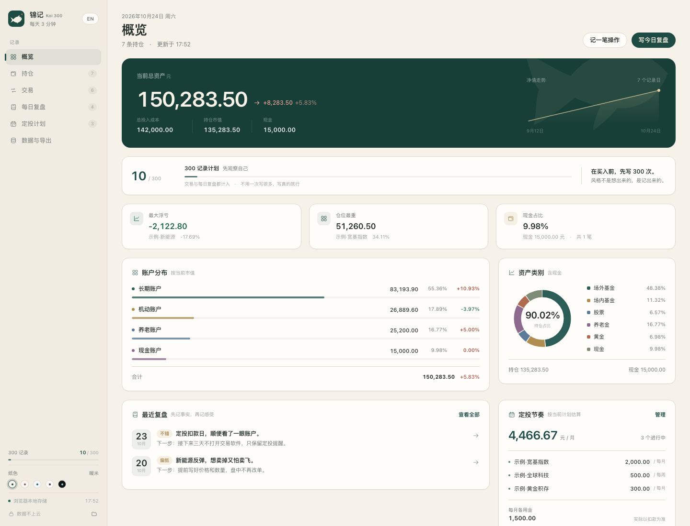
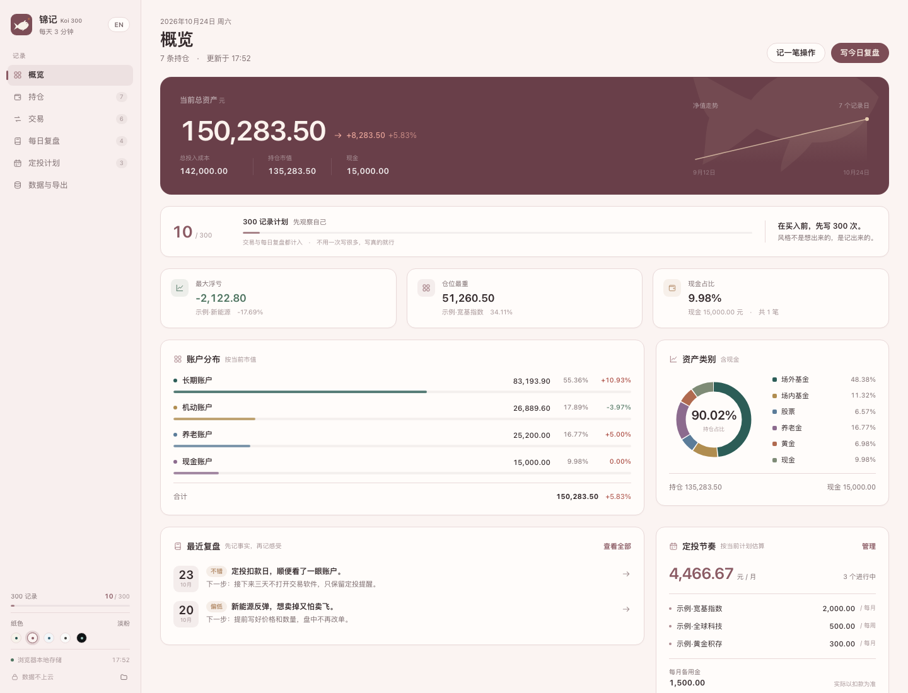
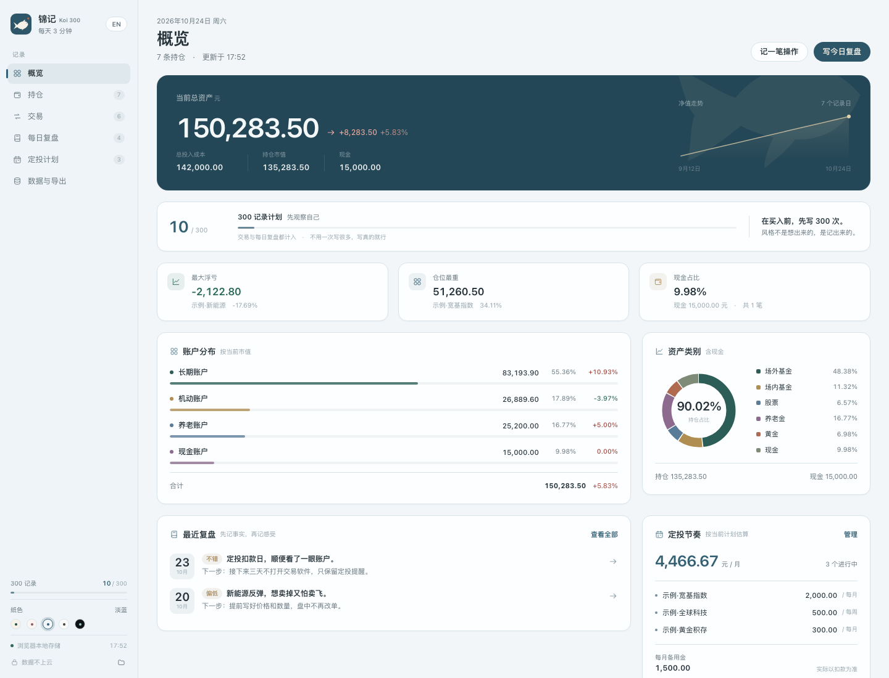
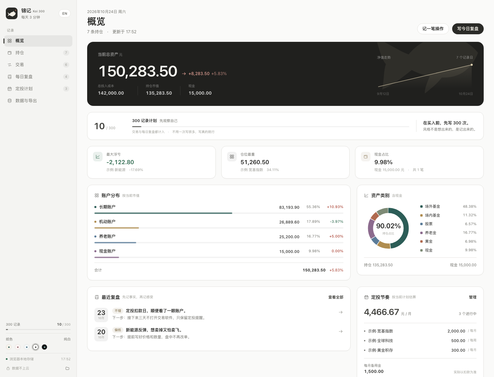
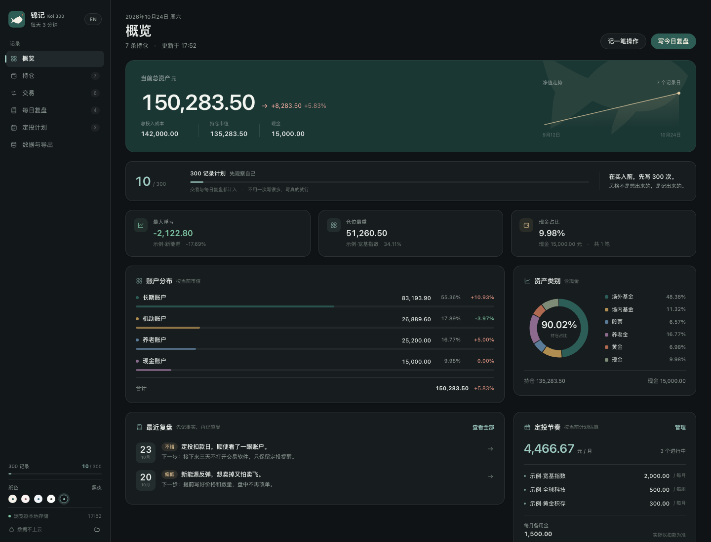
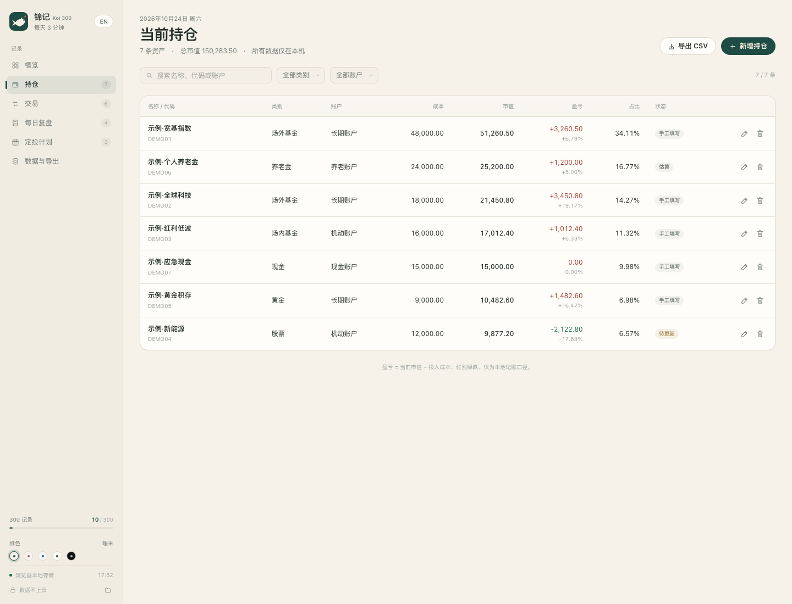
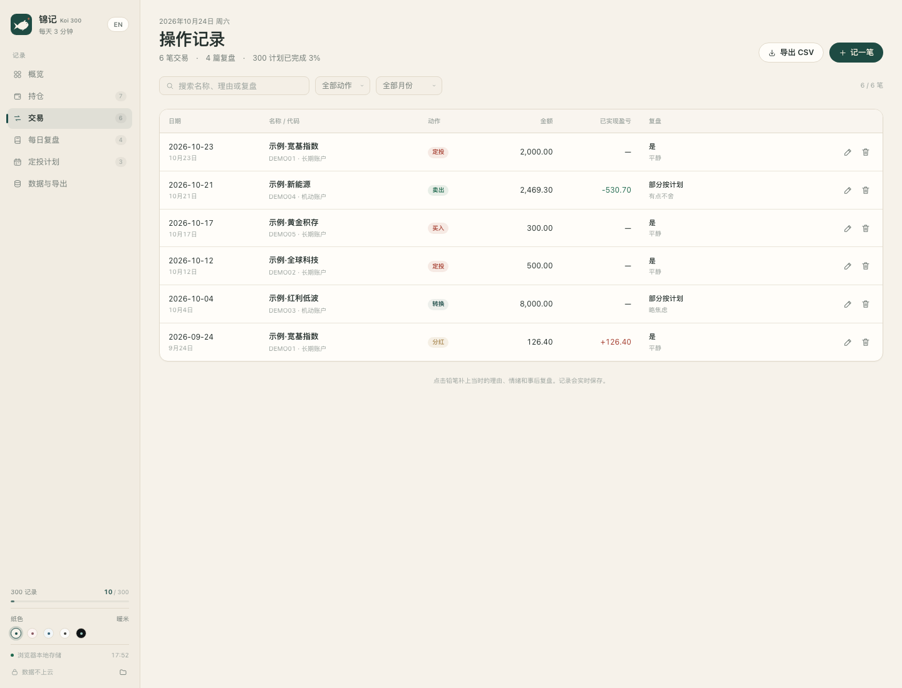
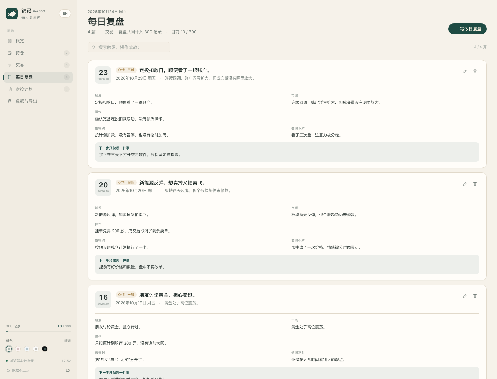
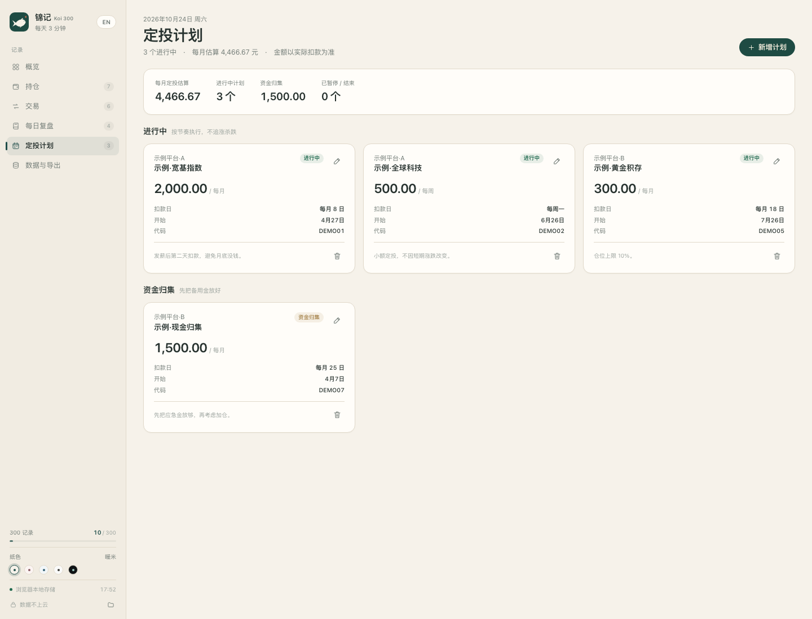
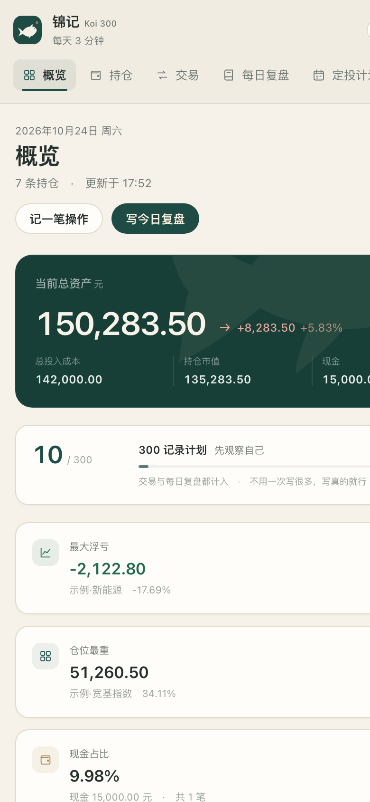

<p align="center">
  
</p>

# 锦记

**在买入前，先写 300 次。风格不是想出来的，是记出来的。**

标识是一条锦鲤：不追浪，先看清水向。

一个本地优先的投资复盘工具：记录持仓、交易与当时的判断，每天写下几行事实，再慢慢形成自己的节奏。没有账号，没有云端，没有行情推送，也不替你预测涨跌。

300 是这个项目给自己定的练习量，不是名人名言，也不是收益承诺。

[在线演示](https://ohhhqz-star.github.io/koi-300/zh/) · [English](README.md) · [下载](#下载) · [数据格式](docs/DATA.zh-CN.md) · [隐私说明](PRIVACY.zh-CN.md) · [给 agent 的说明](AGENTS.zh-CN.md)



五套纸色，随时切换：

<p>
  
  
  
  
</p>

<details>
<summary>更多界面：持仓、操作记录、每日复盘、定投计划</summary>






</details>

## 它解决什么

大多数人缺的不是更多信息，而是一份能回看的记录：

- 买入前，我到底看到了什么、害怕什么、期待什么？
- 这笔操作是计划的一部分，还是临时起意？
- 下跌时我做了什么，事后看是否仍然成立？
- 我的风格，究竟适合多大仓位、多长周期、多少次操作？

锦记把这些留在本机。交易和每日复盘都计入 300 次记录；数字不是 KPI，只是一面镜子。

## 功能

- **概览**：总资产、成本、现金、账户分布、资产类别、净值走势、最近复盘、定投节奏。
- **当前持仓**：账户、类别、成本、市值、盈亏、占比、备注、下一步。
- **操作记录**：买入、卖出、定投、转换、分红；同时记录理由、情绪、市场与事后复盘。
- **每日复盘**：心情、触发、事实、做对/做错、下一步只做一件事。
- **定投计划**：平台、频率、金额、扣款日、状态、资金归集。
- **300 记录**：交易 + 复盘自动计数，分为「先观察自己 / 节奏正在出现 / 纪律开始成形 / 风格就在附近 / 风格已自成一套」。
- **五套纸色**：暖米、淡粉、淡蓝、纯白、黑夜。
- **中英双语**：桌面端在侧边栏切换「中文 / English」；网页端右上角切换，根地址会跟随系统语言。
- **随时带走**：JSON 完整备份；持仓、交易、复盘、计划四类 CSV；带 UTF-8 BOM，Excel / Numbers 可直接打开。
- **本地文件模式**：数据是普通 JSON，agent 可以直接读写，页面会自动检测外部修改并刷新。
- **完全离线**：没有 CDN、统计脚本、字体服务或第三方请求。

## 下载

| 平台 | 文件 | 说明 |
| --- | --- | --- |
| macOS 14+ | `Koi300-macOS-1.2.2-universal.zip` | 原生 SwiftUI 应用，Apple Silicon 与 Intel 通用 |
| Windows 10/11 | `Koi300-Setup-1.2.2.exe` | 传统 NSIS 安装包，按当前用户安装，无需管理员权限 |

在 [Releases](https://github.com/ohhhqz-star/koi-300/releases) 下载。

> 两个桌面版本都内置中英文界面。macOS 在侧边栏「语言」里切换，立即生效；窗口顶部的系统菜单栏（文件 / 前往 / 导出）会在下次启动时使用所选语言。应用文件名与数据目录保持 `Koi 300`，中文界面标题显示为「锦记」。

### macOS 首次打开

应用没有 Apple Developer 证书，采用 ad-hoc 签名。第一次打开时：

1. 解压后把 `Koi 300.app` 拖进「应用程序」。
2. 右键 App → **打开** → 再点一次 **打开**。
3. 如果系统仍然拦截，在终端执行：

```bash
xattr -dr com.apple.quarantine "/Applications/Koi 300.app"
```

数据位置：`~/Library/Application Support/Koi 300/data.json`

### Windows 首次打开

双击安装包，按向导完成安装。默认安装到当前用户目录，不需要管理员权限；卸载时不会自动删除数据。

数据位置：`%APPDATA%\Koi 300\data\portfolio.json`

也可以在应用菜单「文件 → 打开数据文件夹」直接查看。

## 三种使用方式

### 1. 桌面应用（推荐）

- macOS：原生 SwiftUI 版本，数据保存在 `Application Support`，界面可切换中英文。
- Windows：Electron 壳 + 本地 Node 服务，窗口内运行同一套 Web UI，同样可切换中英文。
- 两端都可以导入/导出同一份 JSON。

### 2. 浏览器 + 本地文件（适合 agent）

需要 Node.js 18+：

```bash
git clone https://github.com/ohhhqz-star/koi-300
cd koi-300
./start-mac.command        # macOS
# 或双击 start-windows.bat  # Windows
```

浏览器会打开 `http://127.0.0.1:4877/`，按上次选择或系统语言跳到 `/zh/` 或 `/en/`。数据写入 `data/portfolio.json`，备份写入 `data/backups/`。服务只监听回环地址，关闭终端即停止。

### 3. 纯浏览器（GitHub Pages）

[在线演示](https://ohhhqz-star.github.io/koi-300/zh/) 使用浏览器 `localStorage`，不需要安装。数据留在这台设备的这个浏览器里，换浏览器或清理站点数据会丢失；重要数据请先导出 JSON。页面右上角可以在中文 / English 之间切换。

<p>
  
</p>

## 交给 agent

本地文件模式下，数据就是一个普通 JSON 文件。可以直接让 agent：

> 请先备份 `data/portfolio.json`，再读取并修改我的投资复盘数据。保持 `schemaVersion=1`、字段名和 UUID 不变；日期用 `YYYY-MM-DD`。修改后写回同一路径，应用会在几秒内自动刷新。不要上传或提交到公开仓库。

也可以走本机 API：

```bash
curl http://127.0.0.1:4877/api/status
curl http://127.0.0.1:4877/api/data
curl -X POST http://127.0.0.1:4877/api/backup
curl -X PUT -H 'Content-Type: application/json' \
  --data-binary @data/portfolio.json \
  http://127.0.0.1:4877/api/data
```

接口只接受本机同源请求，拒绝跨站写入。**不要把 4877 端口转发到公网。**

字段、枚举与兼容性约定见 [docs/DATA.zh-CN.md](docs/DATA.zh-CN.md)；给 AI agent 的项目约束见 [AGENTS.zh-CN.md](AGENTS.zh-CN.md)。

## 隐私

- 没有账号、云端同步、遥测或广告。
- 应用不主动发起任何外部网络请求。
- 数据以明文 JSON 保存在本机，**没有加密**。请保护电脑登录密码，并定期导出备份。
- 不要把包含真实数据的 JSON、截图或备份提交到公开仓库。
- 详细说明：[PRIVACY.zh-CN.md](PRIVACY.zh-CN.md)

## 从源码构建

### macOS 原生版

要求 macOS 14+、Xcode Command Line Tools：

```bash
cd mac
./build.sh
```

脚本会编译 arm64 与 x86_64，合并为通用二进制，做 ad-hoc 签名，输出：

```text
mac/dist/Koi300-macOS-1.2.2-universal.zip
```

### Windows 安装包

Windows 安装包在 GitHub Actions 的 `windows-latest` 上构建（本机没有 Windows / Wine 也能发版）：

```bash
cd desktop
npm ci
npm run dist
```

产物在 `desktop/dist/Koi300-Setup-1.2.2.exe`。推送 `v*` 标签会触发 `.github/workflows/release.yml`，同时构建 macOS 与 Windows，并创建 Release。

### Web

Web 是零依赖的静态站点：`web/` 是中文界面（锦记），`site/` 是英文界面（Koi 300），`shell/` 负责按语言跳转。GitHub Pages 由 `.github/workflows/pages.yml` 把三者组装成 `/zh/` 与 `/en/` 两个入口。`server/server.js` 只使用 Node 内置模块。

## 目录

```text
koi-300/
├── shell/               # 语言跳转页（/ → /zh/ 或 /en/）
├── site/                # 英文 Web 界面（Koi 300，GitHub Pages /en/）
├── web/                 # 中文 Web 界面（锦记，GitHub Pages /zh/，桌面端内置）
├── server/              # 本地文件服务 + JSON API
├── mac/                 # 原生 SwiftUI 源码与构建脚本
├── desktop/             # Electron Windows 封装
├── docs/DATA.zh-CN.md   # 数据格式与 API
├── docs/screenshots/    # 虚构示例数据截图
├── start-mac.command
└── start-windows.bat
```

## 设计说明

配色取自纸张、墨色与一点朱砂。默认暖米；可在侧边栏切换淡粉、淡蓝、纯白与黑夜。红涨绿跌遵循 A 股习惯，但界面刻意降低饱和度，避免把注意力从记录本身带走。

示例数据中的名称、代码与金额全部是虚构的，仅用于展示界面。

## 免责声明

这是一个记录工具，不提供投资建议、估值、买卖信号或收益预测。所有数字由用户自行填写，准确性由用户负责。投资有风险，决策请独立判断。

## License

[MIT](LICENSE)
